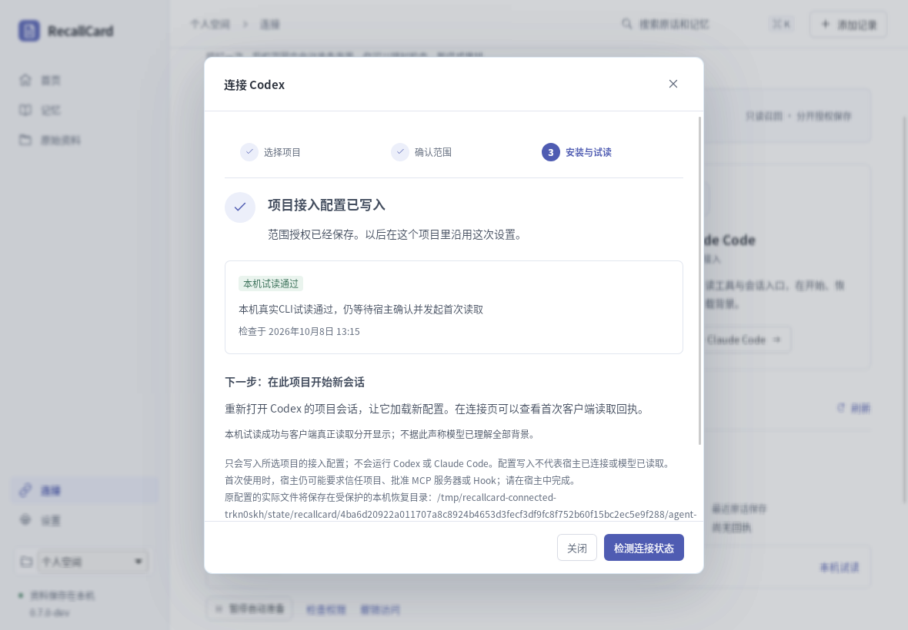

# RecallCard

**让不同 AI 查到你的资料，接着上一次工作继续。**

RecallCard 把聊天原文和记忆保存在你自己的本地资料库。导入官方存档后，既可以查原话，也可以为一个 Agent 项目授权读取背景与出处。CLI、桌面界面和浏览器桥共用同一份正本。

当前工作分支是 **0.7 开发候选版**。主分支和旧交付包保留；本页描述此分支已经实现和验证的范围。

2026-10-11 恢复分支已通过真实 Linux 桌面 8 步闭环：原生导入、原话回看、项目授权、同库 MCP、重启与撤权；628 项 Rust 回归通过。GUI 与 CLI 固定同一干净提交 `5b647111`。全部使用合成数据，未执行外部 Agent 或验证真实 ChatGPT 账号。[查看精确验收范围](docs/native-recovery-validation-20261011.md)。下方恢复候选包另经解压、逐文件校验与真实首屏启动验证。

默认双阶段整理也已通过真实人工 HTTPS 网关验证：新建记忆、候选重导出、用户改口整合、人工审批、目录读回及处理中撤权。使用合成数据，不需要付费模型。[复现与验收边界](docs/manual-staged-gateway.md)。

## 从导入到继续工作

1. **导入旧聊天**：打开桌面版，选择 ChatGPT / DeepSeek 官方导出的 ZIP 或 JSON，立即查看原始资料。
2. **连接项目**：选择 Codex 或 Claude Code、项目目录与读取范围，审阅文件变更后一次授权。
3. **按需取回背景**：项目入口刷新经过授权的文件视图；AI 再通过只读 MCP 搜索、读取和追溯原话。补充近况会进入同一资料库。

没有整理出记忆时，软件诚实显示来源目录。无需为了导入或本地检索先配置模型。

截图来自运行包的真实原生验收，使用合成项目；本机试读与宿主实际读取分别记录。

## 当前能用到哪里

| 入口 | 已实现 | 仍需区分的边界 |
|---|---|---|
| Linux 桌面版 | 官方归档导入、原文阅读、连接向导、一次授权、状态与撤权 | 开发候选版，其他桌面平台未完成验收 |
| CLI / MCP | 独立导入、搜索、长文续读、来源、受管理连接和后台服务 | 实际模型是否正确采用背景需要单独验证 |
| Codex / Claude Code | 项目配置预览与合并、自动入口、授权文件视图、本机真实试读 | 本次未执行外部 Agent；本机试读不等于客户端已读取 |
| ChatGPT / DeepSeek 网页 | 开发扩展、悬浮接力、显式复制／粘贴、分页与暂停 | 手动加载测试扩展；用户点击发送；真实账号页面未验 |
| 后台整理 | 配置范围与预算、可暂停的本地服务 | 真实模型质量、计费和旧记忆自动过时没有全面验证 |
| Qwen Studio | 尚未接通 | 实验性 Qwen 适配不代表 Studio 支持 |

## 下载与开始

[下载当前 Linux 恢复候选包](https://github.com/Micraow/RecallCard/actions/runs/38126585487/artifacts/11697917224)（GitHub 登录后下载外层 ZIP，再完整解压里面的运行 ZIP）。应用基线 `631d37e`，构建 `66e9b7f`，含本次双阶段修复。Ubuntu 22.04 / x86_64 已完成包内 CLI、运行库、逐文件校验及[实际首屏绘制复验](https://github.com/Micraow/RecallCard/actions/runs/38127468784)。这是开发候选版，未发布正式 release；此包的启动 smoke 与此前完整八步验收范围分别记录。

运行 ZIP 的 SHA256：`d5a8ec940115cae49ffa322c02d7105148f644b55dc390c5b5f58e9663e733cc`。旧 `9603053` 包保留为历史版本，不含恢复修复。

解压整个包后运行 `./运行桌面版.sh`；命令行使用 `./recallcard --help`。需要 Git、GLIBC 2.35+、GTK 3、WebKitGTK 4.1，可选模型工作器需要 Python 3.10+。

请先读 [中文上手与升级说明](docs/desktop-quickstart-v0.7.md)，尤其是备份、项目级授权、同文件系统事务限制及浏览器测试版的范围。

## 资料属于你

Event 和 Memory 文件是事实源，索引与视图可重新生成。每个连接按范围读取，读取与保存分开授权。撤权会使受管理视图失效并拒绝后续请求；已经被模型服务接收的内容无法收回。密钥、真实聊天存档和本机状态不进入本项目仓库。

## 了解更多

- [项目接入与文件视图](docs/agent-install-v0.7.md)
- [网页悬浮接力](extension/RELAY.md)
- [长文读取与续页](docs/read-pages-v0.6.md)
- [后台整理运行时](docs/background-memory-v0.6.md)
- [双阶段人工网关复验](docs/manual-staged-gateway.md)
- [开发前检查](docs/preflight.md) · [产品方向](docs/product-reboot-v0.6.md)

原生验收使用合成官方归档和临时项目，覆盖真实文件选择、配置写入、文件视图更新、同库 MCP、重启和撤权；没有把测试通过等同于所有 AI 宿主已经接通。
